# 魔法少女喵喵队

移动端 H5 横版自动奔跑小游戏：单指跳跃、踩怪弹跳连击、猫咪伙伴机关、关底魔法清场。共 5 章 50 关，含 10 场首领战与开放结局。

**在线试玩：** https://eason-xi.github.io/magical-meow-squad/ （手机请横屏；电脑点鼠标或按空格跳跃）


## 游戏截图

| | |
|:---:|:---:|
| 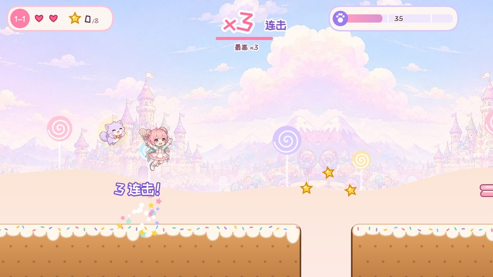<br>**1-1 初次起飞** · 一次起跳，踩着怪物一路连击 | 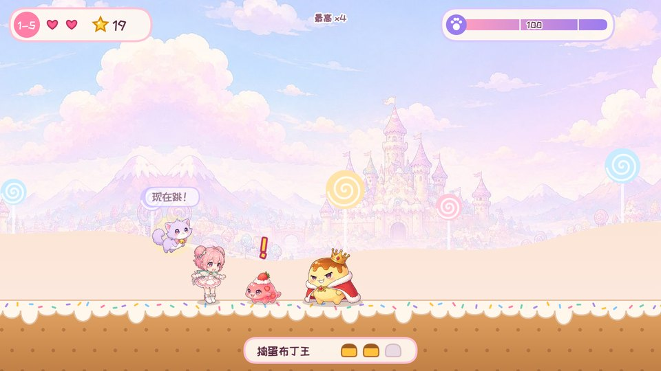<br>**1-5 布丁王** · 站定迎击，猫咪提示"现在跳！" |
| 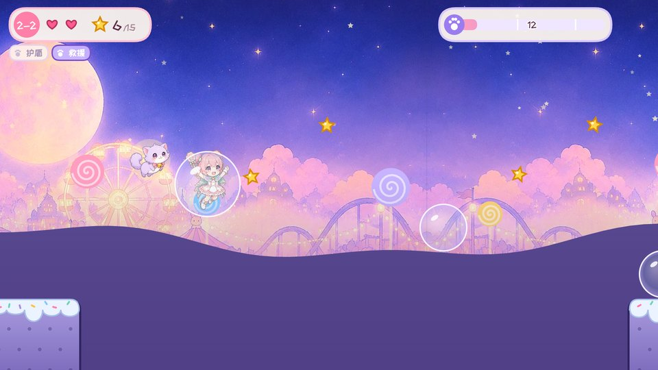<br>**2-2 泡泡天空** · 反重力泡泡托着你飞过大坑 | 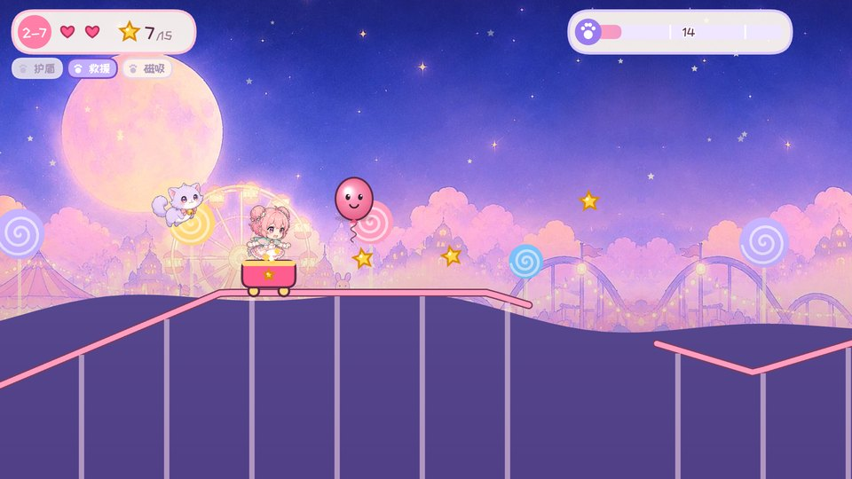<br>**2-7 月光过山车** · 连人带车跳过断轨 |
| 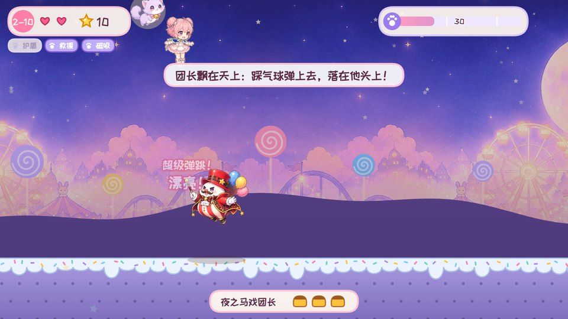<br>**2-10 夜之马戏团** · 踩破气球超级弹跳，落在团长头上 | 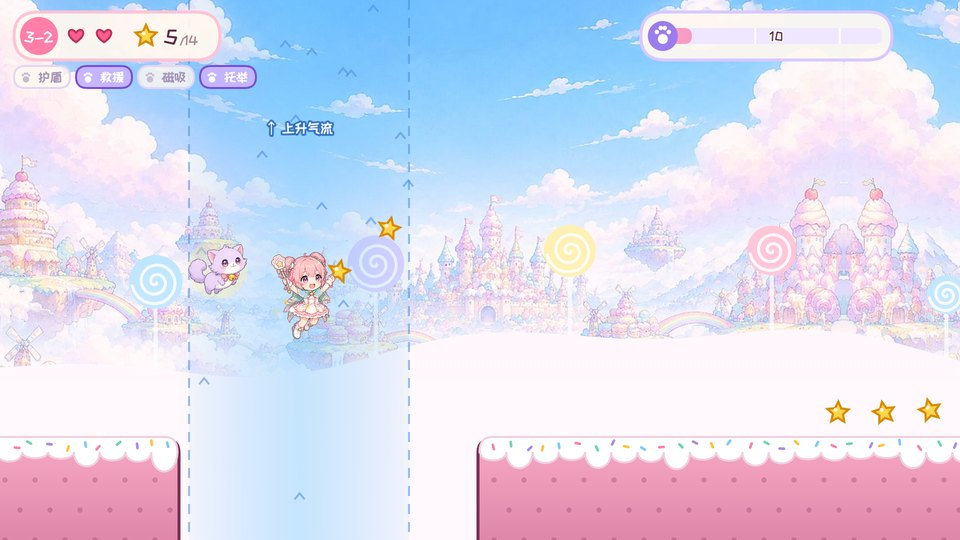<br>**3-2 上升气流** · 走进气柱被托着飘过去 |
| 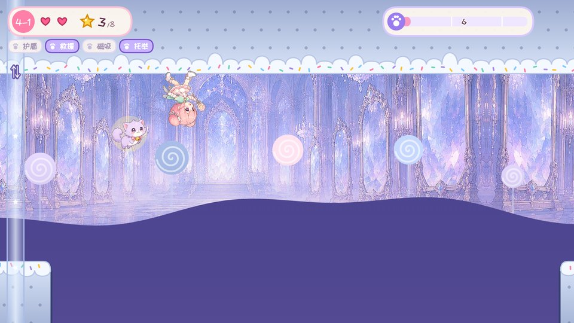<br>**4-1 镜像大厅** · 穿过镜像门，倒过来贴着天花板跑 | 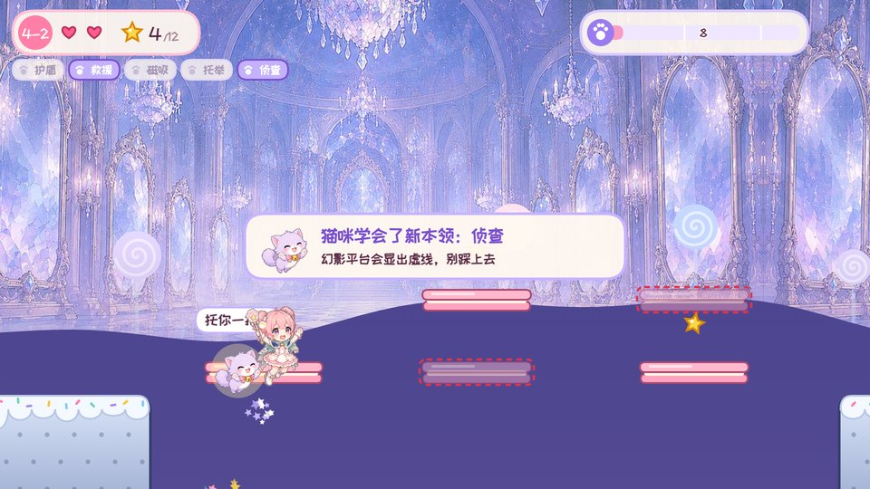<br>**4-2 幻影平台** · 猫咪学会侦查，把幻影标成虚线 |
| 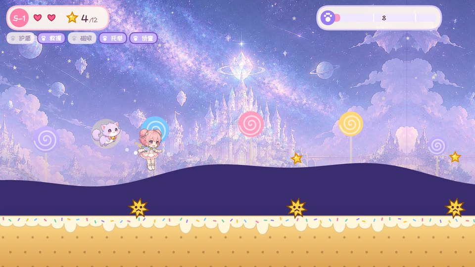<br>**5-1 星刺之路** · 星刺球不能踩，只能跳过去 | 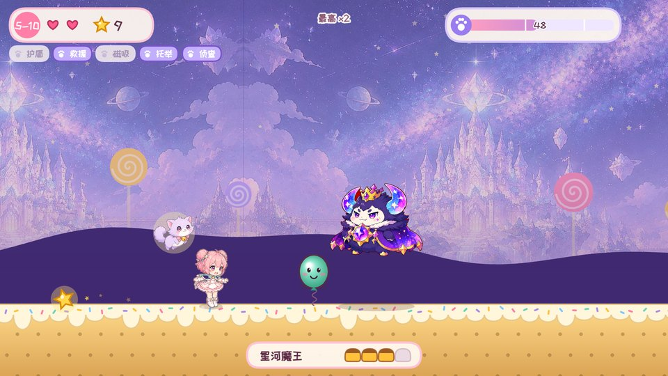<br>**5-10 星河魔王** · 最终首领，4 格血量 |

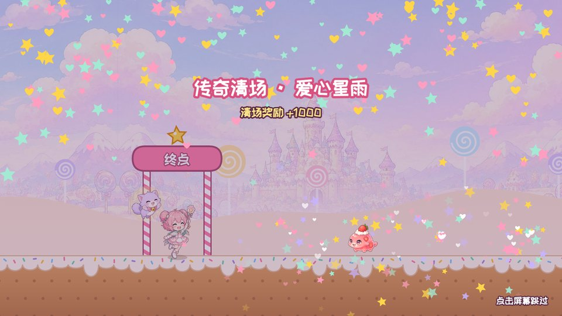
<p align="center"><b>关底魔法清场</b> · 能量越高演出越华丽：星光波 → 猫咪魔法阵 → 爱心星雨</p>

## 五个章节

| 章节 | 新玩法 | 首领 |
|------|--------|------|
| 1 糖果森林 | 点击跳跃、二段跳、踩怪连击、猫咪机关、真假糖果门、完美弹跳、飞飞怪、崩塌饼干平台 | 布丁王、可可熊大王 |
| 2 月光游乐园 | 移动平台、反重力泡泡、印记机关、跳跳小丑、气球怪超级弹跳、过山车；猫咪学会连击护盾、坑边救援、星星磁吸 | 月光魔术兔、夜之马戏团长 |
| 3 云端甜品城 | 顺风 / 逆风、上升气流、糖果小鸟；猫咪学会托举 | 棉花糖云巨人、甜点风神 |
| 4 镜像魔法馆 | 镜像门重力翻转、幻影平台、镜子幽灵、说反话的路牌；猫咪学会侦查 | 镜子小丑、镜之女王 |
| 5 星河城堡 | 星刺球、全部机关混合的高手挑战 | 流星骑士、星河魔王 |

跑速逐章提高（220 → 256 px/s）。第 3～5 章用按跑速自动排布的关卡分段库生成，坑宽、连踩间距都按跑速换算；每关都用内置求解器验证过可以无伤通关。

## 目录

| 路径 | 内容 |
|------|------|
| `魔法少女喵喵队_PRD_长期迭代版_v1.0.md` | 产品需求文档 |
| `demo/` | 游戏本体：单文件 Canvas 游戏 + 精灵与背景素材 |
| `docs/screenshots/` | README 用的游戏截图 |
| `art/concept/` | 角色、场景、HUD 概念图 |
| `art/raw/` | AI 生成的精灵原图与背景原图 |
| `art/tools/cut_sprites.py` | 把精灵原图抠成透明底并切片到 `demo/assets/sprites/` |
| `art/tools/build_run.py` | 把 6 帧跑步循环按头部对齐、统一画布 |
| `art/tools/serve.py` | 本地预览服务器 |

## 本地预览

```bash
python3 art/tools/serve.py 8765 demo
```

然后打开 http://localhost:8765/ 。

## 部署

推送到 `main` 且改动涉及 `demo/` 时，GitHub Actions 会自动把游戏发布到 GitHub Pages（见 `.github/workflows/pages.yml`）。
